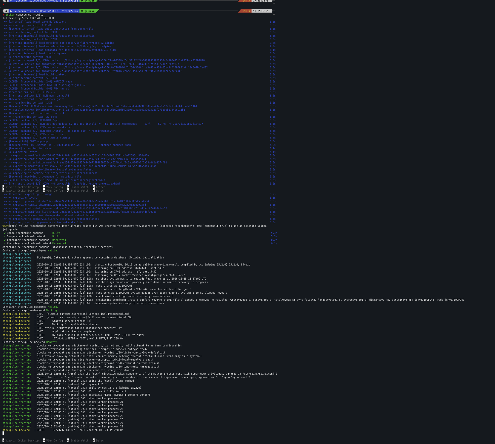
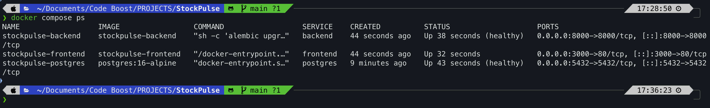

# StockPulse — Modern Warehouse & Product Inventory Platform

[](https://github.com/tanishqsingh/stockpulse/actions)
[](https://www.docker.com/)
[](https://kubernetes.io/)
[](https://www.terraform.io/)
[](https://fastapi.tiangolo.com/)

StockPulse is a production-grade 3-tier cloud-native warehouse and inventory management platform designed to track SKUs, live stock levels, automated low-stock threshold alerts, category distributions, and real-time inventory valuations.

Built for the **DevOps Capstone Project (100 Points / 30% Weightage)**, this repository demonstrates the entire lifecycle of an enterprise microservice: from local Python development to multi-stage containerization, automated pytest quality gates, container security scanning (DevSecOps with Trivy), Kubernetes orchestration with Helm, AWS Infrastructure as Code with Terraform, and real-time observability via Prometheus & Grafana.

---

## 1. Architecture Overview

```text
                  +----------------------------------------------+
                  |                 USER BROWSER                 |
                  |             http://localhost:3000            |
                  +----------------------+-----------------------+
                                         |
                                         | Reverse Proxy (/api, /health)
                                         v
+--------------------------------------------------------------------------------+
| DOCKER COMPOSE / KUBERNETES PODS                                               |
|                                                                                |
|   +--------------------------+                 +---------------------------+   |
|   |         FRONTEND         |                 |          BACKEND          |   |
|   |       React + Vite       | -- proxy /api ->|       FastAPI Python      |   |
|   |      (Nginx Alpine)      |                 |    (Uvicorn + Non-root)   |   |
|   |       Port: 3000/80      |                 |         Port: 8000        |   |
|   +--------------------------+                 +-------------+-------------+   |
|                                                              |                 |
|                                                  SQLAlchemy  | /metrics        |
|                                                   + Alembic  | scrape          |
|                                                              v                 |
|                                                +-------------+-------------+   |
|                                                |         DATABASE          |   |
|                                                |       PostgreSQL 16       |   |
|                                                |    Named Volume Storage   |   |
|                                                |         Port: 5432        |   |
|                                                +---------------------------+   |
+--------------------------------------------------------------+-----------------+
                                                               |
                                                               v
                                                 +-------------+-------------+
                                                 |        OBSERVABILITY      |
                                                 |    Prometheus + Grafana   |
                                                 |  Metrics Dashboard (p95)  |
                                                 +---------------------------+
```

---

## 2. 10-Module Rubric Implementation

| Module | Course Topic | Status | Implementation Details |
| :--- | :--- | :---: | :--- |
| **M1** | **3-Tier Application** | Complete | FastAPI backend, PostgreSQL database with Alembic migrations, responsive React/Vite UI with live database synchronization. |
| **M2** | **Testing & Quality** | Complete | 11 comprehensive Pytest test cases with isolated in-memory test database fixture in `backend/tests/`. |
| **M3** | **Git & GitHub** | Complete | Clean Git repository structure, comprehensive `.gitignore`, `.env.example`, and meaningful conventional commits. |
| **M4** | **Docker & Compose** | Complete | Multi-stage `frontend/Dockerfile` (Node + Nginx), non-root `backend/Dockerfile`, root `docker-compose.yml` with named volume and healthchecks. |
| **M5** | **CI/CD Pipeline** | Complete | 5-stage GitHub Actions workflow in `.github/workflows/ci-cd.yml` (Test -> Build -> Scan -> Push -> Deploy). |
| **M6** | **DevSecOps (Trivy)** | Complete | Automated Trivy container vulnerability scanner targeting backend and frontend images in the CI pipeline. |
| **M7** | **Terraform (AWS IaC)**| Complete | Production AWS IaC in `terraform/`: VPC, 2 public subnets, 2 private subnets, NAT Gateway, EKS Cluster, and managed node group. |
| **M8** | **Kubernetes + Helm** | Complete | Production Helm chart in `helm/stockpulse/` and local Kind manifests in `ktest/` with 2 replicas each, probes, and Ingress routing. |
| **M9** | **Observability** | Complete | `/metrics` endpoint instrumented with Prometheus; Helm values in `monitoring/` and Grafana JSON dashboard. |
| **M10**| **Documentation** | Complete | End-to-end technical documentation, order-of-implementation testing guide, and presentation guidelines. |

---

## 3. Order of Implementation & Testing Flow

Follow this exact sequence demonstrated in the course:

### Phase 1: Local Native Execution (Without Docker)

#### 1. Backend Setup
```bash
cd backend
python3 -m venv .venv
source .venv/bin/activate
pip install -r requirements.txt
cp .env.example .env
alembic upgrade head
uvicorn app.main:app --reload --port 8000
```
- Swagger UI: `http://localhost:8000/docs`
- Health check: `http://localhost:8000/health`
- Prometheus metrics: `http://localhost:8000/metrics`

#### 2. Run Backend Tests
```bash
cd backend
source .venv/bin/activate
pytest -v
```

#### 3. Frontend Setup
```bash
cd frontend
npm install
npm run dev
```
Open `http://localhost:3000` to interact with the responsive dashboard.

---

### Phase 2: Run with Docker (Individual Containers)

```bash
# Build backend container
docker build -t stockpulse-backend:latest ./backend

# Build frontend container (multi-stage)
docker build -t stockpulse-frontend:latest ./frontend
```

---

### Phase 3: Run with Docker Compose (Full Stack)

Start all services (PostgreSQL, Backend, Frontend) with a single command:
```bash
docker compose up --build -d
```

Verify running containers and health checks:
```bash
docker compose ps
```

Expected output:
```text
NAME                  IMAGE                    STATUS                    PORTS
stockpulse-backend    devopsproject-backend    Up (healthy)              0.0.0.0:8000->8000/tcp
stockpulse-frontend   devopsproject-frontend   Up                        0.0.0.0:3000->80/tcp
stockpulse-postgres   postgres:16-alpine       Up (healthy)              0.0.0.0:5432->5432/tcp
```

Tear down stack (preserving persistent volume):
```bash
docker compose down
```

Tear down and delete volume:
```bash
docker compose down -v
```

---

### Phase 4: Local Kubernetes Deployment (Kind Cluster)

Using the `ktest/` manifests specifically created for local Kind cluster testing:

```bash
# Create local Kind cluster
kind create cluster --name stockpulse-cluster

# Create namespace
kubectl apply -f k8s/namespace.yaml

# Deploy application stack
kubectl apply -f ktest/deployment.yaml
kubectl apply -f ktest/service.yaml

# Verify pods and services
kubectl get pods -n stockpulse
kubectl get svc -n stockpulse
```

#### Or Deploy via Production Helm Chart:
```bash
helm upgrade --install stockpulse ./helm/stockpulse -n stockpulse --create-namespace
helm list -n stockpulse
```

---

### Phase 5: DevSecOps Vulnerability Scan (Trivy)

Run security audit on container images locally:
```bash
trivy image --severity HIGH,CRITICAL devopsproject-backend:latest
trivy image --severity HIGH,CRITICAL devopsproject-frontend:latest
```

---

### Phase 6: Infrastructure as Code (Terraform for AWS)

The Terraform configuration provisions AWS VPC, subnets, and an EKS cluster:

```bash
cd terraform
terraform init
terraform validate
terraform plan
```

> **Note on AWS Cost Protection:** Per instructor guidelines, `terraform apply` is optional and not required for grading. Creating valid, syntactically verified HCL configurations satisfies Module 7 without consuming AWS credits.

---

## 4. REST API Reference

| Method | Endpoint | Description |
| :--- | :--- | :--- |
| `GET` | `/` | Root service metadata and navigation links |
| `GET` | `/health` | Liveness probe: returns `{"status": "up"}` |
| `GET` | `/ready` | Readiness probe: verifies live PostgreSQL connection |
| `GET` | `/metrics` | Prometheus metrics endpoint |
| `GET` | `/api/inventory` | List all inventory items (supports `q`, `category`, `stock_status`) |
| `GET` | `/api/inventory/{id}` | Retrieve details for a single inventory item |
| `POST` | `/api/inventory` | Register a new warehouse inventory item |
| `PUT` | `/api/inventory/{id}` | Update stock quantity, thresholds, and pricing |
| `DELETE` | `/api/inventory/{id}` | Deregister an inventory item |
| `GET` | `/api/inventory/stats` | KPI aggregate statistics and total inventory valuation |

---

## 5. Required Screenshots Checklist for Submission

Paste the following required screenshots directly into this section prior to final submission:

### 1. Terminal output of `docker compose up --build`
<!-- Screenshot Placeholder: docker compose up output showing build and startup -->


### 2. Output of `docker compose ps`
<!-- Screenshot Placeholder: docker compose ps showing all 3 healthy containers -->


### 3. Backend Swagger UI (`/docs`)
<!-- Screenshot Placeholder: Swagger UI showing all endpoints and version -->


### 4. Backend Health Endpoint (`/health`)
<!-- Screenshot Placeholder: JSON output of /health showing status "up" -->


### 5. Prometheus Metrics Endpoint (`/metrics`)
<!-- Screenshot Placeholder: Raw output from /metrics -->


### 6. Successful GitHub Actions CI/CD Pipeline Run
<!-- Screenshot Placeholder: GitHub Actions showing all 5 stages green -->


---

## 6. Final Presentation (PPT) Guidelines

As specified by the instructor, the final presentation deck must be kept clean, understandable by a non-technical audience, and contain **only these 4 screenshots**:
1. **GitHub Actions CI/CD Pipeline Run**: Showing automated test, build, scan, push, and deploy stages.
2. **Main Repository Codebase**: Demonstrating clean file hierarchy, `.github`, `backend`, `frontend`, `helm`, `ktest`, and `terraform`.
3. **Local Kubernetes Deployment**: Terminal output of `kubectl get pods -n stockpulse` showing running pods.
4. **Docker Compose Output**: Manual run of `docker compose ps` with healthy services.
