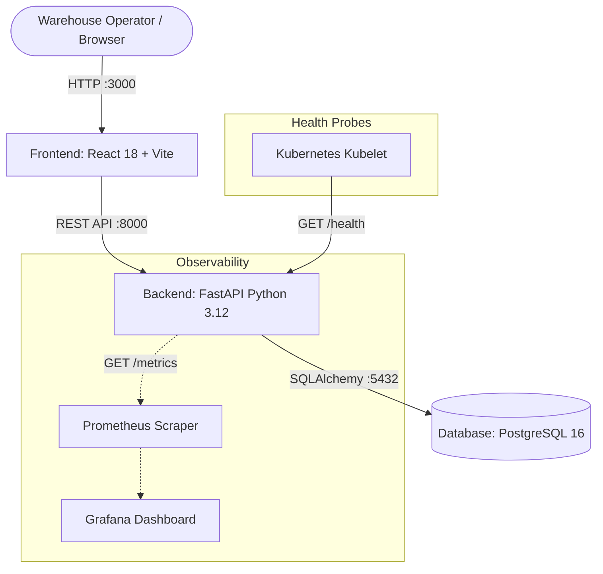

# StockPulse — Architecture & Technical Design

StockPulse is a production-ready, cloud-native warehouse and inventory management platform designed with microservices principles, declarative infrastructure, and automated DevSecOps pipelines.

---

## 1. System Architecture Overview

StockPulse follows a resilient 3-tier architecture:



---

## 2. Microservice Components

### Tier 1: Frontend (Client Presentation)
- **Framework**: React 18 with Vite build tooling and Tailwind CSS styling.
- **Production Server**: Lightweight Alpine Nginx (`nginx:alpine`) running as a non-privileged user.
- **Responsibilities**:
  - Live inventory dashboard displaying stock levels, SKU codes, quantities, and reorder thresholds.
  - Interactive restock and adjustment modal forms.
  - Real-time stock status badges (In Stock, Low Stock, Critical).
  - Responsive layout optimized for desktop dispatch monitors and warehouse mobile tablets.

### Tier 2: Backend (Business Logic & API)
- **Framework**: FastAPI (Python 3.12) running under Uvicorn ASGI server.
- **ORM & Validation**: SQLAlchemy 2 with Pydantic v2 data models.
- **Responsibilities**:
  - High-throughput asynchronous endpoints for stock ingestion, batch updates, and audit logging.
  - Concurrency-safe database transactions preventing double-deduction race conditions.
  - Built-in OpenAPI / Swagger documentation (`/docs`) and ReDoc (`/redoc`).
  - Liveness and readiness endpoints (`/health`) with active database ping.
  - Prometheus metrics exporter (`/metrics`) instrumented with `prometheus-fastapi-instrumentator`.

### Tier 3: Database (Persistent Relational Store)
- **Engine**: PostgreSQL 16 Alpine.
- **Responsibilities**:
  - ACID-compliant relational storage for inventory catalog, warehouses, and transaction ledgers.
  - Strict foreign key constraints and indexed lookup on SKU and barcode fields.
  - Persistent storage backed by Docker Named Volumes locally and AWS EBS gp3 volumes on Kubernetes.

---

## 3. Containerization & DevSecOps

Both container images are engineered according to enterprise security standards:
- **Multi-Stage Builds**: Build tools (Node.js, npm, compilers) are isolated to the build stage and stripped from the final runtime container.
- **Least Privilege (Non-Root)**:
  - Backend runs as non-root user `appuser` (UID 10001).
  - Frontend runs as non-root user `nginx` (UID 101).
- **Automated Security Scanning**:
  - Integrated with Aqua Security's **Trivy** in the CI/CD pipeline.
  - Scans OS libraries and language dependencies against CVE databases before deployment.

---

## 4. Kubernetes Topology & Orchestration

The application is packaged and deployed using a production-ready **Helm chart** (`helm/stockpulse`):

```
stockpulse (Namespace)
├── Deployments
│   ├── stockpulse-backend (2 replicas, HPA-enabled)
│   └── stockpulse-frontend (2 replicas, HPA-enabled)
├── StatefulSet
│   └── stockpulse-postgres (1 replica, PersistentVolumeClaim)
├── Services
│   ├── stockpulse-backend (ClusterIP :8000)
│   ├── stockpulse-frontend (ClusterIP :80)
│   └── stockpulse-postgres (ClusterIP :5432)
├── Ingress
│   └── stockpulse-ingress (Host routing & path prefixes)
├── Autoscaling
│   └── stockpulse-hpa (HorizontalPodAutoscaler: 50% CPU target, min 2, max 5)
└── Monitoring
    └── ServiceMonitor (Scrapes /metrics every 15s)
```

### Self-Healing & High Availability:
- **Liveness Probes**: Continuously check `/health` to restart unhealthy or deadlocked containers.
- **Readiness Probes**: Ensure traffic is only routed to pods once the database connection pool is warm.
- **Resource Requests & Limits**: Explicit CPU and Memory requests prevent noisy neighbor issues.

---

## 5. Infrastructure as Code (Terraform AWS EKS)

The cloud infrastructure is provisioned through modular Terraform files located in `terraform/`:
- **VPC Module**: Custom VPC (`10.0.0.0/16`) in AWS Sydney (`ap-southeast-2`) with 2 public subnets and 2 private subnets across multiple Availability Zones.
- **EKS Cluster**: Managed Kubernetes control plane (Kubernetes v1.31) with AWS IAM authenticator.
- **Node Groups**: Auto-scaling managed EC2 node group (`t3.medium` instances) configured with IAM worker policies.
- **Zero-Waste Lifecycle**: All resources are verified via `terraform plan` and cleanly destroyed via `terraform destroy` after verification to incur near-zero cloud cost.
